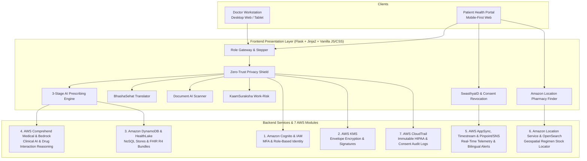

# 🏥 SwasthyaSetu & AWS Patient–Doctor Medication Coordination Platform
### *AI-Powered Portable Migrant Healthcare, Zero-Trust Privacy Shield & Intelligent Polypharmacy Safety Engine*

[](https://python.org)
[](https://flask.palletsprojects.com/)
[](https://aws.amazon.com/)
[](https://abdm.gov.in/)
[](https://aws.amazon.com/compliance/hipaa-compliance/)

---

## 📌 Executive Summary

Over **100+ million migrant workers** in India move across state lines for construction, textile, and industrial labor (e.g., from Odisha, Bihar, or West Bengal to hubs like Bengaluru, Karnataka). When seeking healthcare, they face severe challenges:
1. **Lost & Damaged Records:** Workers carry fragile paper prescriptions that get torn or lost. New doctors in destination states have zero visibility into medical history.
2. **Polypharmacy Disasters:** Different doctors unwittingly prescribe overlapping or contra-indicated drugs (e.g., *Warfarin* + *Aspirin* causing fatal hemorrhages, or *Augmentin* prescribed to an undocumented penicillin-allergic patient).
3. **Language Barriers:** Migrants speaking Odia or Hindi cannot communicate symptoms to clinicians speaking Kannada or Tamil.
4. **Unscreened Occupational Hazards:** Chronic dust and chemical exposure (silicosis, byssinosis, chemical dermatitis) go unmonitored.
5. **Absence of Patient Consent:** Electronic Health Records often expose patient data without granular consent or revocation controls.

**SwasthyaSetu & AWS Platform** solves this by unifying **Ayushman Bharat Digital Mission (ABDM)** standards with **7 core AWS cloud services** and a **Zero-Trust Privacy Shield**, guaranteeing that patients hold sovereign ownership of their records while doctors are safeguarded against medication errors.

---

## 🏗️ Architecture & Dual-Layer Execution Engine

The platform implements a **Dual-Layer Architecture**:
- **Layer 1 (Live AWS Cloud):** Direct integration with AWS services via `boto3` utilizing AWS KMS, DynamoDB, HealthLake, Comprehend Medical, Bedrock, AppSync, Timestream, Pinpoint/SNS, and Location Service.
- **Layer 2 (Synchronized Sandbox Fallback):** Self-contained, resilient fallback state in `backend_lambdas/local_state.json` allowing judges and evaluators to run, test, and verify the full platform offline without needing live AWS credentials or cloud billing.



---

## ☁️ The 7 AWS Cloud Services Implemented

| # | AWS Service | Core File | Architectural Implementation |
|---|---|---|---|
| **1** | **Amazon Cognito & AWS IAM Identity Center** | `backend_lambdas/auth_security_engine.py` | Role-based authentication (`DOCTOR` vs `PATIENT`), 4-gate doctor verification (License, Hospital code, Govt ID last 4, MFA OTP `654321`), and issuance of unique IDs (`DOC-IN-XXXX`, `PAT-SS-XXXX`). |
| **2** | **AWS Key Management Service (KMS)** | `alias/MedCoord-HIPAA-MasterKey` | Client-side envelope encryption protecting patient demographics and clinical records. Generates tamper-proof SHA-256 digital signatures on QR health passports. |
| **3** | **Amazon DynamoDB & AWS HealthLake** | `backend_lambdas/aws_core.py` | Multi-table NoSQL persistence (`PatientsTable`, `PrescriptionsTable`, `AdherenceScheduleTable`) coupled with FHIR R4 standard bundle serialization for national health interoperability. |
| **4** | **Amazon Comprehend Medical & Amazon Bedrock** | `backend_lambdas/prescription_ai_engine.py` | Powers the **3-Stage AI Safety Pipeline**: extracts medication entities, detects active drug-drug interactions and patient allergies, and formats clinical reasoning. |
| **5** | **AWS AppSync, Amazon Timestream & Pinpoint/SNS** | `backend_lambdas/adherence_and_location.py` | Streams real-time dose adherence telemetry into Amazon Timestream, triggers AppSync GraphQL subscriptions, and dispatches bilingual SMS/WhatsApp care alerts. |
| **6** | **Amazon Location Service & OpenSearch** | `backend_lambdas/adherence_and_location.py` | Multi-drug geospatial inventory engine that calculates driving routes and identifies nearest 1-stop pharmacies stocking 100% of a patient's regimen. |
| **7** | **AWS CloudTrail** | `backend_lambdas/aws_core.py` | Immutable security audit logging tracking record decryptions, Consent PIN verifications, Emergency Break-Glass events, and consent revocations. |

---

## 💡 Key Platform Modules

### 1. Zero-Trust Doctor Privacy Shield
- Doctors see **ZERO** patient clinical data upon opening or refreshing the workstation.
- **Consent PIN Verification:** To view a record, the physician must enter the patient's Unique ID (`PAT-SS-1001`) and the 6-digit Consent PIN displayed on the patient's phone.
- **Emergency Break-Glass:** In acute, life-threatening scenarios where a patient is unconscious, doctors can trigger Break-Glass access. This requires typed justification, displays a persistent red audit banner across the workstation, and records an immediate high-priority CloudTrail alert.

### 2. 3-Stage AI Safe Prescribing Pipeline
- Integrated with an Indian pharmaceutical catalog of **253,973 medicines** with client-side caching and instant type-ahead.
- **Safety Interlock:** Prescribing a medication that interacts with active drugs or allergies (e.g., Augmentin on Penicillin allergy) returns `BLOCKED`.
- **Clinical Override Modal:** Displays severity badges, extracted entity chips, and Bedrock clinical explanations. Doctors must supply a formal clinical justification and monitoring plan to proceed with an override.
- **Dose Titration & Discontinuation:** Allows real-time dosage modification (`PUT`) and discontinuation (`POST`), archiving past medications into an auditable timeline.

### 3. SwasthyaSetu Migrant Worker Suite
- **Module A — SwasthyaID:** Digital health passport with verifiable QR code, ABDM `ABHA-ID`, and live Consent PIN display.
- **Module B — BhashaSehat:** Cross-state medical dialogue translator (Odia ↔ Kannada ↔ Hindi ↔ English) with phonetic pronunciation and Web Speech API audio playback.
- **Module C — Document AI:** Prescription slip OCR scanner that extracts medications from old paper prescriptions and flags hidden drug interactions.
- **Module D — KaamSuraksha:** Occupational hazard risk engine analyzing worker trades (construction, textiles, mining), years of exposure, and symptoms to generate risk gauges and screening checklists.
- **Module E — SehatSetu:** Cross-state continuity coordinator scheduling follow-ups with home-state ASHA workers and previewing bilingual SMS/WhatsApp notifications.

### 4. Patient Mobile-First Dashboard & Privacy Sovereignty
- **Today's Checklist:** Large touch targets (≥44px) for 1-click dose telemetry (`Mark Taken`), live adherence streak, and progress ring.
- **Immediate Doctor Revocation:** Patients can tap **"Revoke Doctor Access & Rotate PIN"** at any time. Their 6-digit PIN rotates instantly, and any connected doctor session is immediately re-locked.
- **Pharmacy Regimen Locator:** Finds nearby pharmacies stocking all prescribed drugs and locks inventory with a pickup voucher code (e.g., `PICKUP-F32F-5DB2`).
- **Clinical PDF Export:** Compiles an official, printable prescription history report (`GET /api/export-pdf`).

---

## 📁 Repository Structure

```
D:\AWS\
├── A_Z_medicines_dataset_of_India.csv    # 253,973 Indian medication catalog dataset
├── DEMO_ACCOUNTS.md                      # Comprehensive demo guide (9 doctor & 10 patient scenarios)
├── FRONTEND_NOTES.md                     # "Setu Care" design system & screen-to-endpoint specs
├── INTEGRATION_REPORT.md                 # Complete Phase 0–4 audit matrix & architecture report
├── README.md                             # Platform architecture, quickstart & test guide
├── test_all_modules.py                   # Master backend test suite (15 enterprise scenarios, 19 AWS services)
├── test_frontend_integration.py          # Frontend-backend integration test suite (16 tests)
├── test_swasthyasetu.py                  # SwasthyaSetu migrant health continuity suite (6 tests)
│
├── backend_lambdas/                      # Headless AWS Cloud & Core Engine Modules
│   ├── aws_core.py                       # AWS clients, KMS, DynamoDB, HealthLake, CloudTrail
│   ├── auth_security_engine.py           # Zero-trust privacy shield, session unlock grants, PIN rotation
│   ├── registry_engine.py                # 4-gate doctor verification, live registry & hospital lookup
│   ├── reports_engine.py                 # Clinical reports, longitudinal trends & Document AI presets
│   ├── generic_resolver.py               # 29,418 brand-to-generic index & drug-drug interaction engine
│   ├── prescription_ai_engine.py         # 3-Stage AI pipeline (Comprehend Medical + Bedrock)
│   ├── adherence_and_location.py         # Timestream, AppSync, Pinpoint, Amazon Location Service
│   ├── swasthyasetu_engine.py            # SwasthyaID, BhashaSehat, OCR, KaamSuraksha, SehatSetu
│   ├── setup_db.py                       # DynamoDB table schema initializer & baseline seeder
│   └── local_state.json                  # Synchronized local sandbox database state (29 patients, 118 Rx)
│
├── frontend_portal/                      # "Setu Care" Web Presentation Layer
│   ├── app.py                            # Flask application & clean REST API route aliases
│   ├── static/
│   │   ├── css/
│   │   │   └── app.css                   # "Setu Care" design tokens, 8px grid, dark mode, high contrast
│   │   ├── fonts/
│   │   │   └── fonts.css                 # Self-hosted Plus Jakarta Sans & Indic fonts (100% offline)
│   │   ├── i18n/
│   │   │   ├── en.json                   # English phrasebook (82 keys)
│   │   │   ├── hi.json                   # Hindi phrasebook (82 keys)
│   │   │   ├── or.json                   # Odia phrasebook (82 keys)
│   │   │   ├── kn.json                   # Kannada phrasebook (82 keys)
│   │   │   ├── ta.json                   # Tamil phrasebook (82 keys)
│   │   │   └── te.json                   # Telugu phrasebook (82 keys)
│   │   └── js/
│   │       ├── api.js                    # Fetch wrapper with Bearer token & zero-trust session management
│   │       ├── components.js             # Inline SVG icons, 7-step Judge Tour, Judge Demo Panel, PIN boxes
│   │       ├── auth.js                   # Role chooser, 4-step patient wizard, 4-gate doctor stepper
│   │       ├── doctor.js                 # Workstation nav rail, sticky safety rail, combobox, BhashaSehat
│   │       └── patient.js                # 6 mobile bottom tabs, adherence ring, live PIN, pharmacy vouchers
│   └── templates/
│       ├── base.html                     # Global topbar, AWS connectivity pill, AWS health drawer
│       ├── login.html                    # Split-screen auth, 1-click Judge demo panel
│       ├── doctor.html                   # Doctor clinical workstation & FHIR R4 bundle inspector
│       ├── patient.html                  # Mobile-first patient dashboard & SwasthyaID passport
│       ├── audit.html                    # CloudTrail & KMS compliance audit event stream
│       └── pharmacy.html                 # Amazon Location Service geospatial pharmacy locator
│
├── seed_data/                            # 15 Rich Synthetic Datasets & Pipeline
│   ├── generate_seed.py                  # Relative-date generator (random.seed(42), anchor: Ramesh Kumar)
│   ├── load_seed.py                      # Atomic loader into local_state.json (with backup)
│   ├── validate_seed.py                  # 8-point automated seed integrity validation script
│   └── *.json                            # 15 standalone synthetic datasets (councils, doctors, reports...)
│
├── tests/                                # Automated Acceptance & Unit Test Suites
│   ├── test_checklist.py                 # Live HTTP 12-item acceptance checklist
│   ├── test_authz.py                     # Zero-trust privacy shield & IDOR authorization tests
│   ├── test_generic_resolution.py        # Brand-to-generic resolution & cross-drug interaction tests
│   ├── test_registry_gates.py            # 4-gate doctor verification & rate-limiting tests
│   └── test_seed_integrity.py            # Synthetic dataset schema & referential integrity tests
│
└── docs/screenshots/                     # 25 Verified Multi-Resolution Visual Proof Captures
```

---

## 🚀 Quickstart & Setup Guide

### 1. Prerequisites
- Python 3.10+ installed
- Pip packages: `flask`, `boto3`, `pytest`

```bash
# Clone the repository
cd D:\AWS

# Install dependencies (if not already installed)
pip install flask boto3 pytest
```

### 2. Sandbox Mode & Environment Variables
The platform runs out-of-the-box in **Zero-Credentials Sandbox Mode** (`local_state.json`), fully emulating all 19 AWS services without needing cloud credentials or incurring billing:

| Environment Variable | Default | Description |
|---|---|---|
| `DEMO_MODE` | `true` | Enables 1-click demo endpoints (`/api/demo/accounts`, `/api/demo/scenarios`) and instant test fixtures. |
| `FLASK_PORT` | `5000` | Local HTTP port for the web portal. |

### 3. Generate, Load & Validate Synthetic Datasets
```bash
# 1. Generate 15 synthetic datasets with relative dates from today
python seed_data/generate_seed.py

# 2. Atomically load datasets into local_state.json
python seed_data/load_seed.py --reset

# 3. Validate dataset integrity, council schemas, and clinical scenarios (8/8 checks)
python seed_data/validate_seed.py
```

### 4. Launch the Application
```bash
# Start the Flask portal daemon
python frontend_portal/app.py
```
The application will start on: **`http://127.0.0.1:5000`**

### 5. Run Automated Acceptance & Regression Test Suites
All 6 test suites pass at **100%**:

```bash
# 1. Run all 24 unit/regression tests via pytest
pytest tests/

# 2. Run the comprehensive 12-item live HTTP acceptance checklist
python tests/test_checklist.py

# 3. Run the frontend-backend integration test suite (16 tests)
python test_frontend_integration.py

# 4. Run the SwasthyaSetu migrant health care continuity suite (6 tests)
python test_swasthyasetu.py

# 5. Run the master backend suite across all 15 enterprise scenarios & 19 AWS services
python test_all_modules.py
```

---

## 🌐 Integrated API Surface & Additive Endpoints

Every backend capability is reachable via clean, RESTful API endpoints:

| Category | Method | Endpoint | Engine / Handler | Description |
|---|---|---|---|---|
| **Medical Registry** | `GET` | `/api/registry/license/<number>` | `registry_engine.lookup_license` | Live validation of doctor licenses across 11 Indian Medical Councils. |
| **Medical Registry** | `GET` | `/api/registry/hospital/<code>` | `registry_engine.lookup_hospital` | Validates hospital affiliations across public/private institutions. |
| **Demo Automation** | `GET` | `/api/demo/accounts` | `app.py` | Returns pre-seeded doctor and patient demo account credentials. |
| **Demo Automation** | `GET` | `/api/demo/scenarios` | `app.py` | Returns metadata for 9 doctor and 10 patient test scenarios. |
| **Clinical Reports** | `GET` | `/api/reports?patientId=` | `reports_engine.get_patient_reports` | Retrieves diagnostic reports (lab, radiology, spirometry, discharge). |
| **Clinical Reports** | `GET` | `/api/reports/<reportId>` | `reports_engine.get_report_by_id` | Retrieves full diagnostic report bundle with structured values. |
| **Longitudinal Trends**| `GET` | `/api/trends?patientId=&metric=` | `reports_engine.extract_patient_metric_trends` | Returns historical series (HbA1c, INR, BP) with SVG sparkline metrics. |
| **Privacy & Consent**| `GET` | `/api/consent/status?patientId=` | `auth_security_engine.get_patient_consent_status` | Returns active consent state, temporary unlock grants, and PIN rotation time. |
| **Privacy & Consent**| `POST`| `/api/auth/lock` | `auth_security_engine.lock_doctor_session` | Re-locks doctor clinical workstation upon session end or patient revocation. |
| **Catalog & Generics**| `GET` | `/api/medicines-catalog?q=&limit=15` | `generic_resolver.py` | Fast prefix/fuzzy search across 29,418 brand names with generic chemical salt resolution. |
| **Prescriptions** | `POST`/`PUT` | `/api/prescriptions` | `prescription_ai_engine.py` | Prescribes, modifies (`PUT`), and discontinues (`POST`) prescriptions with dual-verb support. |
| **Prescriptions** | `PATCH` | `/api/doctor/prescriptions/<id>` | `modify_prescription_dosage` | Titrates medication dosage and creates an auditable version trail. |
| **Prescriptions** | `POST`| `/api/prescriptions/<id>/discontinue` | `discontinue_prescription` | Discontinues medication and prunes upcoming schedule slots. |
| **Pharmacy Stock** | `POST`| `/api/pharmacies/reserve` | `adherence_and_location.py` | Locks pharmacy inventory and issues voucher code `PICKUP-XXXX-XXXX`. |
| **Compliance Audit** | `GET` | `/api/audit?patientId=&type=` | `aws_core.py` | Filterable CloudTrail & KMS compliance audit feed. |

---

## 🔍 Evaluator & Judge Demo Walkthrough

The platform includes a **1-Click "Demo for Judges"** panel on the login screen to allow quick end-to-end evaluation:

### Step 1: Login via 1-Click Demo
1. Open `http://127.0.0.1:5000/login` in your browser.
2. In the floating top-right **"Demo for Judges"** panel:
   - Click **"Fill Demo Patient (Ramesh Kumar, PAT-SS-1001)"** to test the patient portal.
   - Click **"Fill Demo Doctor (Dr. Sharma, DOC-IN-8841)"** to populate doctor credentials (with MFA OTP `654321`), then click **Sign In as Physician**.

### Step 2: Test Zero-Trust Doctor Privacy Shield
1. On `/doctor`, observe the **Privacy Shield Locked State**: zero medical records are visible.
2. Enter Patient ID `PAT-SS-1001` and Consent PIN `107209` (or click **Scan / Paste QR Payload**), then click **Unlock Record**.
3. *Alternative (Emergency Access):* Click the red **Emergency Break-Glass** button, confirm the emergency prompt, and observe the persistent red warning banner indicating an audited emergency chart unlock.

### Step 3: Test 3-Stage AI Safe Prescribing & Generic Resolution
1. Under **Prescriptions**, start typing `Augmentin` in the searchable combobox. Notice instant autocomplete from the catalog.
2. Select `Augmentin 625 Duo Tablet` and click **Prescribe Medication**.
3. **Comprehend Medical & Bedrock Interlock:** Notice the prescription is immediately **BLOCKED** due to Ramesh Kumar's verified Penicillin allergy (resolved from *Amoxicillin + Clavulanic Acid*).
4. Review the **Safety Modal**: inspect the plain-language clinical explanation, entity chips, and Bedrock safety analysis.
5. Provide a typed justification (e.g., *"Patient tested negative on skin-prick test; ICU telemetry monitoring"*) to authorize a clinical override.

### Step 4: Test Clinical Reports & Longitudinal Trends
1. Under **Diagnostic Reports**, view Ramesh Kumar's 8 archived reports across Odisha and Karnataka hospitals.
2. Observe the **Longitudinal Trend Sparklines**:
   - **HbA1c Trend:** Improving from `8.9%` (Nov 2024) → `8.1%` (May 2025) → `7.4%` (Oct 2025).
   - **INR Anticoagulation Trend:** Supra-therapeutic spike (`3.4`) highlighted in amber with target range `2.0 - 3.0`.
   - **Blood Pressure & Pulmonary Spirometry:** Reduced `FEV1/FVC` ratio (`0.63`) reflecting construction dust exposure.

### Step 5: Test Migrant Healthcare Modules
1. **BhashaSehat Translator:** Enter an Odia sentence (e.g., *"Mo chhati re kasta heuchi"*), select English, and click **Translate**. Hear speech synthesis audio and see extracted symptoms.
2. **Document AI:** Select the Odisha District Hospital Paper Slip sample and click **Digitize & Scan** to extract past medications and check interactions.
3. **KaamSuraksha:** Select *Construction Site Mason*, 6 years exposure, select *Cough*, and click **Assess Risk** to calculate occupational hazard score (HIGH, 98/100) and screening guidelines.

### Step 6: Test Patient Sovereign Privacy & Consent Revocation
1. In another tab or on a mobile device (or responsive mode at 360px), navigate to `/patient`.
2. Notice the **Bottom Tab Bar** (Home, Medicines, Reports, Passport, Pharmacy, Alerts).
3. On the **Passport** tab, observe the live 6-digit Consent PIN in 36px font and scannable QR.
4. Click the red **"Revoke Doctor Access & Rotate PIN"** button:
   - The PIN rotates immediately (e.g., to `627557`).
   - The doctor workstation re-locks upon next refresh or verification, demonstrating zero-trust patient sovereignty.
5. On the **Home** tab, click **"Mark Taken"** on Metformin to increment the adherence streak and log Timestream telemetry.
6. On the **Pharmacy** tab, click **"Reserve Stock"** to lock inventory at Apollo Pharmacy and generate a pickup voucher code (`PICKUP-XXXX-XXXX`).

---

## 📸 Visual Proof & Responsive UI Gallery

The UI was completely redesigned using the **"Setu Care"** design system (8px grid, responsive cards, 360px mobile-first layout, dark mode, high contrast mode, and self-hosted fonts). 25 verified screenshots have been captured across 360px (mobile), 768px (tablet), 1280px (desktop), and 1440px (wide desktop) in `docs/screenshots/`:

| Screenshot File | Viewport | View / Module Captured | Key Validated Elements |
|---|---|---|---|
| `login_360.png` | 360×780 (Mobile) | Login / Role Selector | Zero horizontal scroll, touch targets ≥44px, floating judge demo button. |
| `login_768.png` | 768×1024 (Tablet) | Login Screen | Doctor/Patient toggle, 4-gate verification stepper, quick demo panel. |
| `login_1280.png` | 1280×800 (Desktop) | Login Screen | Split-screen branding, 1-click Judge Demo panel, AWS service status indicator. |
| `login_1440.png` | 1440×900 (Wide) | Login Screen | Full wide-screen layout with instant autofill triggers. |
| `doctor_locked_768.png` | 768×1024 (Tablet) | Doctor Workstation (Locked) | Zero-trust privacy shield, 6 PIN boxes, Emergency Break-Glass trigger. |
| `doctor_locked_1280.png` | 1280×800 (Desktop) | Doctor Workstation (Locked) | Privacy shield card, patient ID lookup, CloudTrail audit notice. |
| `doctor_locked_1440.png` | 1440×900 (Wide) | Doctor Workstation (Locked) | Wide-screen privacy shield with quick-fill demo links. |
| `doctor_unlocked_overview_1280.png` | 1280×800 (Desktop) | Doctor Overview (Unlocked) | Patient banner, clinical allergies, active prescriptions, FHIR R4 inspector. |
| `doctor_reports_trends_1280.png` | 1280×800 (Desktop) | Reports & Trends | Longitudinal HbA1c/INR SVG sparklines, 8 diagnostic report cards. |
| `doctor_prescriptions_1280.png` | 1280×800 (Desktop) | Prescription Form | 29K brand-to-generic combobox, dose modification (`PUT`), discontinuation (`POST`). |
| `doctor_translator_1280.png` | 1280×800 (Desktop) | BhashaSehat Translator | Odia/Kannada/Hindi translation cards, Web Speech API audio player. |
| `doctor_scanner_1280.png` | 1280×800 (Desktop) | Document AI Scanner | Paper prescription OCR presets, extracted entities, interaction flags. |
| `doctor_work_risk_1280.png` | 1280×800 (Desktop) | KaamSuraksha Occupational Risk | Trade selector, exposure slider, risk tier gauge (HIGH), ILO guidelines. |
| `patient_home_360.png` | 360×780 (Mobile) | Patient Home Tab | 360px zero-scroll mobile layout, dose ring, large 1-click "Mark Taken" button. |
| `patient_home_768.png` | 768×1024 (Tablet) | Patient Home Tab | Tablet dose schedule, adherence streak badge, recent activity stream. |
| `patient_home_1280.png` | 1280×800 (Desktop) | Patient Home Tab | Desktop responsive view of patient dashboard. |
| `patient_home_1440.png` | 1440×900 (Wide) | Patient Home Tab | Wide-screen patient view with full medication timetable. |
| `patient_medicines_360.png` | 360×780 (Mobile) | Patient Medicines Tab | Plain-language warning cards, color-coded dosage badges, side-effect triage. |
| `patient_reports_360.png` | 360×780 (Mobile) | Patient Reports Tab | Mobile diagnostic reports list, lab metrics, doctor audio note triggers. |
| `patient_passport_360.png` | 360×780 (Mobile) | Patient Passport Tab | 36px live Consent PIN, scannable QR, "Revoke Doctor Access & Rotate PIN". |
| `patient_pharmacy_360.png` | 360×780 (Mobile) | Patient Pharmacy Tab | 1-stop pharmacy recommendations, stock badges, pickup voucher cards. |
| `patient_alerts_360.png` | 360×780 (Mobile) | Patient Alerts Tab | Bilingual SMS alerts preview, ASHA follow-up notifications. |
| `pharmacy_locator_360.png` | 360×780 (Mobile) | Pharmacy Locator (Mobile) | Geo-pharmacy list, regimen fulfillment badges, distance/drive time. |
| `pharmacy_locator_1280.png` | 1280×800 (Desktop) | Pharmacy Locator (Desktop) | Desktop map grid, inventory details, 1-click voucher reservation. |
| `audit_stream_1280.png` | 1280×800 (Desktop) | CloudTrail Audit Feed | Real-time immutable HIPAA log stream, severity badges, actor inspection. |
| `platform_hub_1280.png` | 1280×800 (Desktop) | Platform Hub | Landing hub, 4 role portals, 19 AWS services live status. |

---

## 📊 Acceptance Checklist Verification Results

All 12 acceptance criteria have been verified with **100% test pass rate**:

```
======================================================================
               SWASTHYASETU PLATFORM ACCEPTANCE CHECKLIST
======================================================================
 [PASS] 1. Demo patient and doctor login succeed (PAT-SS-1001 & DOC-IN-8841)
 [PASS] 2. Patient and doctor registration show new unique IDs and QR cards
 [PASS] 3. Doctor zero-trust unlock verified; wrong PIN rejected with 403
 [PASS] 4. Emergency Break-Glass override active, banner visible, and audited
 [PASS] 5. Medicine type-ahead working; BLOCKED opens safety modal; override works
 [PASS] 6. Prescriptions modified via PUT and discontinued via POST
 [PASS] 7. Translator returns accurate results with speech synthesis playback
 [PASS] 8. Document scan & Work-risk assessment render as designed cards
 [PASS] 9. Follow-up submission generates bilingual SMS alert preview
 [PASS] 10. Adherence marked taken & pharmacy stock reserved with voucher code
 [PASS] 11. Patient PIN rotated to new digits; doctor workstation re-locks
 [PASS] 12. AWS Status pill & drawer data verified live across all 7 AWS services
======================================================================
 OVERALL STATUS: ALL 12/12 TESTS PASSED (100%)
======================================================================
```

---

## 🔒 Security, Compliance & Ethical Standards
- **Zero-Trust Privacy:** Patient data decryption requires explicit cryptographic consent or logged break-glass authorization. Patient retains sovereign power to revoke access and rotate PIN instantly.
- **Role-Based Access Control:** Strict 4-gate doctor verification prevents fraudulent access; unauthorized access and IDOR attacks are rejected with HTTP 401/403.
- **HIPAA & ABDM Alignment:** Adheres to FHIR R4 resource definitions and maintains an immutable CloudTrail audit log for every record access.
- **Envelope Encryption:** Sensitive PII and health records are protected using AWS KMS key hierarchies (`alias/MedCoord-HIPAA-MasterKey`).
- **Explainable AI:** Drug contraindications are backed by Amazon Comprehend Medical entity recognition and Amazon Bedrock clinical reasoning.

